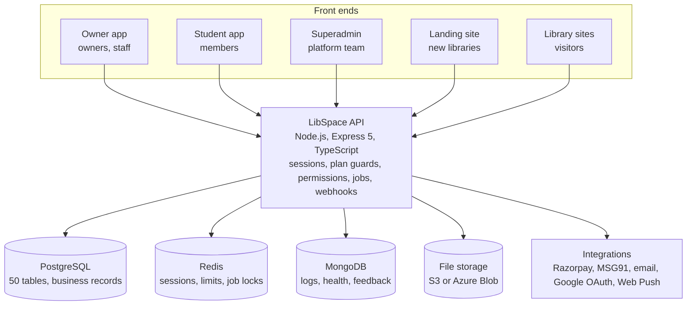

# LibSpace

**A multi-tenant SaaS that runs private self-study libraries end to end: admissions, seats, attendance, fees, books and reports.**

> The source code is private. This repository documents the project: what it does, how it is built, and the problems I solved along the way. I am happy to walk through the code on a screen share.

## Live links

| App | Link | Access |
| --- | --- | --- |
| Product website | [www.libspace.in](https://www.libspace.in/) | Public |
| Library website (demo library) | [library.libspace.in/LIB01](https://library.libspace.in/LIB01) | Public, demo data |
| Owner app | [erp.libspace.in](https://erp.libspace.in/) | Sign-in required; demo access on request |
| Student app | [student.libspace.in](https://student.libspace.in/) | Sign-in required; demo access on request |

## Overview

I built LibSpace on my own, and real libraries use it in production. I covered product design, backend, frontend, payments and DevOps, from the first commit on 24 December 2025 to today.

| | |
| --- | --- |
| Role | Solo full-stack developer and product engineer |
| Period | December 2025 to November 2026, about 11 months |
| Status | Live at [libspace.in](https://www.libspace.in), used by real libraries |
| Scale of the build | 6 apps, about 1,160 commits, about 146,000 lines of TypeScript |
| Backend | About 375 REST endpoints, 50-table PostgreSQL schema, 7 scheduled jobs |

## The problem

Self-study libraries rent desks by time shift to students preparing for competitive exams, and most ran on paper registers and WhatsApp. Owners could not see which seat was free in which shift, chased every fee by hand, and kept no reliable record of attendance or cash. Staff needed full access to do anything, and the owner could not see the business from home.

## What I built

Five front ends on one API, each for a different user:

| App | For | What it does |
| --- | --- | --- |
| Owner app | Library owners and staff | Admissions, seat map, attendance, fees, books, reports, staff roles; mobile-first PWA in five languages |
| Student app | Members | QR check-in, dues and receipts, online and UPI payments, leave, notices; installable PWA |
| Superadmin console | Platform team | Libraries, plans, billing, platform staff with two-factor sign-in, monitoring, job history |
| Landing site | New library owners | Product pages with pricing read live from the API |
| Library websites | A library's visitors | One public site per library, with live seat availability and admission requests |

Key capabilities:

- **Admissions:** a QR code at the desk opens a public form with DPDP consent. The owner approves with the first payment, or with the fee left as due.
- **Attendance:** QR check-in with optional geofencing and shift-aware rules, plus an offline queue at the front desk.
- **Fees:** cash, UPI with owner verification, or online payment straight into the library's own Razorpay account.
- **SaaS billing:** libraries pay for LibSpace by Razorpay autopay or pay-each-time, with versioned plans and plan-gated features.
- **Reports:** 13 plan-gated reports, plus daily and monthly summaries sent to the owner automatically.
- **Messaging:** WhatsApp reminders through MSG91, email, web push and in-app notifications.

## Architecture

One modular Express API serves every app, and all libraries share one PostgreSQL database with each row tagged by its library. Redis holds what every server process must share, and MongoDB keeps high-volume logs out of the main database.

## Engineering highlights

**Payments that never apply twice.** Gateways retry webhooks, and owners sometimes pay in two tabs. Every event is signature-checked, stored once under a unique idempotency key and applied in a transaction. A background job settles payments the app never confirmed.

**A front desk that never waits.** Attendance taps show at once and go into a local outbox, which syncs in batches through a bulk endpoint. Marks survive a dropped connection on patchy mobile data.

**Fast sessions that still revoke instantly.** Sessions are checked through process memory, then Redis, then PostgreSQL, so most requests skip the database. Deactivating a staff member ends their sessions on the next request, and editing a role affects only that role.

**Paid plans on a live product.** Plan-gated features arrived after libraries already used every module. Existing modules stay on unless a plan turns them off, new features start off, and published plan versions are locked. No live library lost a screen.

**Built to run unattended.** Every server runs on UTC, with all dates computed in India time. Scheduled jobs run once across all processes behind distributed locks. Pushes to main deploy to AWS EC2 with zero-downtime reloads and additive-only migrations.

## Timeline

| Period | Phase | Highlights |
| --- | --- | --- |
| Nov 2026 | Payments, reports, operations | WhatsApp fee reminders, UPI and online fee payments, reports centre, five languages, DPDP consent, owner dashboard |
| Oct 2026 | SaaS billing and security | Razorpay autopay and pay-each-time, versioned plans, cookie sessions with rotation, platform staff with two-factor sign-in |
| Jul to Sep 2026 | Growth | Geofenced attendance, part payments and dues, bulk import, onboarding, public library websites |
| Apr to Jun 2026 | Hardening | Time zone fixes, cloud-agnostic storage, secure Google sign-in, landing site, new SaaS plan architecture |
| Feb to Mar 2026 | Platform | CI/CD, weekly backups, superadmin console, WhatsApp and SMS reminders, private document vault |
| Dec 2025 to Jan 2026 | Foundation | Sign-in, roles, staff, students, invoices, subscriptions, QR attendance, student app |

## Tech stack

| Layer | Technology |
| --- | --- |
| Front end | React 19, TypeScript, Vite, MUI, TanStack Query, Redux Toolkit, i18next, PWA; Next.js for library websites |
| Back end | Node.js, Express 5, TypeScript, Prisma, Zod |
| Data | PostgreSQL, Redis, MongoDB, AWS S3 or Azure Blob |
| Integrations | Razorpay, MSG91 WhatsApp, Resend and SMTP email, Google OAuth, Web Push |
| DevOps | GitHub Actions, AWS EC2 with PM2 cluster mode, Vercel |

<!--
## Screenshots

Uncomment this section once the images are in screenshots/ (see screenshots/README.md).

| Owner dashboard | Seat map | Student app |
| --- | --- | --- |
|  |  |  |

| Admission form | Reports centre | Superadmin console |
| --- | --- | --- |
|  |  |  |
-->

## More

- **Project report:** [docs/report.md](docs/report.md) covers the modules, architecture, data model, billing, security, operations and engineering challenges in depth. A fuller internal edition is shared on request.
- **Code walkthrough:** the repositories are private, and I am happy to walk through them on a screen share.
