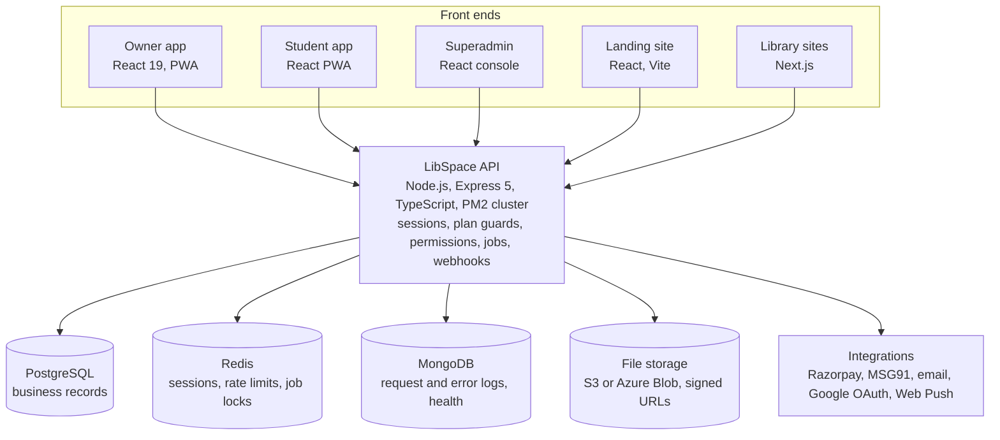

# LibSpace Project Report

**Public edition, November 2026.** This is the shareable version of the full project report. Internal details such as security thresholds, the schema and the endpoint map are left out. The source code is private; I am happy to walk through it on a screen share.

Live product: [libspace.in](https://www.libspace.in/) · Demo library website: [library.libspace.in/LIB01](https://library.libspace.in/LIB01) · All links and the short version: [case study](../README.md)

## Contents

1. [Executive summary](#executive-summary)
2. [The problem and the product](#the-problem-and-the-product)
3. [My role and scope](#my-role-and-scope)
4. [Timeline and milestones](#timeline-and-milestones)
5. [The applications](#the-applications)
6. [Core modules](#core-modules)
7. [System architecture](#system-architecture)
8. [Technology stack](#technology-stack)
9. [Data model](#data-model)
10. [SaaS plans and billing](#saas-plans-and-billing)
11. [Security and privacy](#security-and-privacy)
12. [Reliability and operations](#reliability-and-operations)
13. [DevOps and release process](#devops-and-release-process)
14. [Engineering challenges](#engineering-challenges)
15. [Quality and testing](#quality-and-testing)
16. [What I learned](#what-i-learned)
17. [Glossary](#glossary)

## Executive summary

LibSpace is a multi-tenant SaaS that runs private self-study libraries end to end: admissions, seats, attendance, fees, books and reports. I designed, built and operate it alone. The first commit is dated 24 December 2025, and real libraries use the platform in production.

A library owner runs the business from a mobile-first web app. Students use their own installable app. The platform team manages every library, plan and payment from a superadmin console, while a landing site and per-library websites bring in new members.

What the platform delivers:

- One codebase serves many libraries, with tenant isolation, plan-based features and per-role staff permissions.
- Fees are taken in cash, by UPI with owner verification, or online through the library's own Razorpay account.
- Libraries pay for LibSpace by Razorpay autopay or pay-each-time. A billing job handles renewals, grace periods and plan changes.
- Attendance runs on QR codes, with optional geofencing, shift-aware check-out and an offline queue at the front desk.
- Owners get 13 plan-gated reports, plus a daily and a monthly summary delivered automatically.
- The owner app is available in English, Hindi, Bengali, Marathi and Gujarati.
- Deploys are automated, with scheduled backups and request, error and system-health monitoring.

| Project fact | Value |
| --- | --- |
| Started | 24 December 2025 (first commit) |
| Period covered | December 2025 to November 2026, about 11 months |
| Team | Solo: product, design, backend, frontend and DevOps |
| Applications | 6: API, owner app, student app, superadmin console, landing site, library websites |
| Commits | About 1,160 across all repositories and branches |
| Code | About 146,000 lines of TypeScript in application source |
| Database | PostgreSQL, 50 tables, 76 migrations |
| API | About 375 REST endpoints |
| Scheduled jobs | 7 |

## The problem and the product

Self-study libraries are paid reading rooms where students rent a desk for a time shift and prepare for competitive exams. They are common across Indian towns and cities, and most were run on paper registers, spreadsheets and WhatsApp groups.

### How libraries ran before

- **Seats:** owners could not tell which seat was free in which shift, so seats were sold twice or left empty.
- **Fees:** expiry dates and dues lived in the owner's memory, and every reminder was a manual call or message.
- **Attendance:** a paper register, easy to fake and impossible to report on.
- **Money:** no receipts, no split between cash and UPI, no daily closing total.
- **Control:** staff needed full access to do anything, and the owner could not see the business from home.

### What LibSpace changes

| Pain point | What LibSpace does |
| --- | --- |
| Double-sold or empty seats | Halls and a live seat map per shift, with seats that can be reserved for women |
| Paper admission forms | A QR code at the desk opens a public admission form; the owner approves it in one step |
| Chasing fees | Dues tracked per member, with WhatsApp, email and in-app reminders before and after expiry |
| No payment record | Invoices, receipts, cash and UPI split, voids with a reason, and a daily cash-closing report |
| Fake attendance | QR check-in from the student app, optionally limited to the library's location |
| Owner blind spots | An owner dashboard and 13 reports, plus summaries sent every evening and every month |
| Staff with full access | Roles with per-module permissions, including who may see full phone numbers |

### Who uses it

| User | App | What they do |
| --- | --- | --- |
| Library owner | Owner app | Runs admissions, seats, fees, books, staff, reports and settings |
| Library staff | Owner app | Front-desk work within the permissions of their role |
| Student | Student app | Checks in, pays fees, sees dues and receipts, applies for leave, reads notices |
| Prospective student | Admission form, library website | Applies for a seat without an account |
| Platform team | Superadmin console | Manages libraries, plans, billing, messaging, monitoring and scheduled jobs |

## My role and scope

I am the only engineer on LibSpace. I own the product from the first conversation with a library owner to the production server.

| Area | What I did |
| --- | --- |
| Product and UX | Worked out flows with library owners, designed mobile-first screens and built a shared UI kit |
| Backend | REST API in Node.js, Express 5 and TypeScript; PostgreSQL schema and migrations with Prisma; background jobs |
| Frontend | Owner app, student app, superadmin console and landing site in React; library websites in Next.js |
| Payments | Razorpay subscriptions, autopay mandates, payment links and webhooks; online fee collection; the UPI claim flow |
| Messaging | Email, WhatsApp through MSG91, web push and in-app notifications |
| Security | Sessions, role permissions, platform staff with two-factor sign-in, secret encryption, DPDP consent |
| DevOps | CI/CD with GitHub Actions, PM2 on AWS EC2, Vercel for front ends, backups, monitoring and job history |

### How I work on a live product

- **Additive changes only.** New columns and tables extend existing models; nothing in production is dropped or renamed in place.
- **Deprecate before removing.** Older app versions still call old endpoints, so they stay, marked deprecated, until a later release.
- **Planned deploy order.** The backend ships first when an app needs a new API. The app ships first when the API will start requiring a field it sends.
- **Branches.** Feature branches merge into beta for testing, then into main for production.
- **Visible versions.** Each app shows its version and git commit, so a bug report names the exact build.

## Timeline and milestones

LibSpace went from first commit to a full SaaS in under 11 months, in six phases. Work came in three bursts: the core platform in February and March 2026 (172 commits each), SaaS billing in October (173), and payments and reports in November.

| Period | Phase | What shipped |
| --- | --- | --- |
| Nov 2026 | Payments, reports and operations | WhatsApp fee reminders, UPI and online fee payments; admission with first payment or fee due; reports centre with scheduled summaries; five languages; DPDP consent; owner dashboard; fast attendance sync; seat map redesign; plan modules; job history in the console |
| Oct 2026 | SaaS billing and security | HttpOnly cookie sessions with rotation; Razorpay checkout, autopay mandates, payment links and plan changes; plan versions and feature catalog; loan rules and fines; email change with two codes; platform staff roles with two-factor sign-in; console mobile layout; owner app on a shared UI kit |
| Jul to Sep 2026 | Growth | Announcements, modular jobs, bulk import, onboarding with plan choice; feedback module, admission trends, voids with reasons; geofenced and cross-midnight attendance; part payments and dues on renewal; phone masking; distributed job locks; library websites in Next.js |
| Apr to Jun 2026 | Hardening | Time zone fixes across leave and attendance; indexes; public admission endpoints; library offboarding; storage behind one S3 and Azure interface; secure Google sign-in; WhatsApp Business connection; landing site; global student identity; seat preferences; admission and lifecycle rules; new SaaS plan architecture |
| Feb to Mar 2026 | Platform | CI/CD deploys, weekly backups, expenses, student notifications; superadmin console; API docs, discounts, legacy import, gender-restricted seats, monthly system plans; WhatsApp and SMS reminders; private document vault; metadata-driven multi-tenancy |
| Dec 2025 to Jan 2026 | Foundation | First commit on 24 December: sign-in, roles, staff, students, Docker; invoices, subscriptions, plans and libraries by 30 December; Google sign-in, renewals, email, SaaS subscription, book scan, QR attendance, admission alerts, reminders; student app started 26 January |

## The applications

LibSpace is five front ends on one API. Each one serves a different user and is deployed on its own, so a change to one app does not force a release of the others.

| Application | Users | Stack | Started | Size |
| --- | --- | --- | --- | --- |
| API | All apps, payment webhooks | Node.js, Express 5, TypeScript, Prisma | Dec 2025 | 393 commits, ~49k lines |
| Owner app | Library owners and staff | React 19, Vite 7, MUI, Redux Toolkit, TanStack Query | Dec 2025 | 564 commits, ~56k lines |
| Student app | Members of a library | React, Vite, MUI, TanStack Query, installable PWA | Jan 2026 | 97 commits, ~11k lines |
| Superadmin console | Platform team | React, MUI, TanStack Query, Recharts | Feb 2026 | 59 commits, ~17k lines |
| Landing site | Prospective library owners | React 19, Vite 7, MUI 7 | May 2026 | 33 commits, ~13k lines |
| Library website | A library's own visitors | Next.js, MongoDB | Sep 2026 | 16 commits |

### Owner app

The owner app is where a library is run day to day. It is mobile-first, installable as a PWA, and translated into five languages.

- **Modules:** dashboard, admissions, students, seats and halls, attendance, finance, online payments, books, reports, announcements, staff, plans, settings and the library's website.
- **Onboarding:** a guided tour, a setup checklist, and bulk import from Excel for libraries moving off spreadsheets or older software.
- **Plan awareness:** a module not in the library's plan stays visible with a lock and an Upgrade button. A module the staff member has no permission for is hidden.
- **State:** server data in TanStack Query, session and preferences in Redux Toolkit with encrypted persistence.

### Student app

The student app gives a member everything about their own membership. It is a PWA, so students install it from the browser without an app store.

- Home with the current plan, seat, shift and days left.
- QR check-in and check-out, attendance history.
- Fees: dues, receipts, UPI payment claims and online payment.
- Library: issued books and history; leave requests; notifications from the library.
- MindSprint, a set of short focus games (math, memory, pattern, focus) for study breaks.

### Superadmin console

The console is how the platform team runs LibSpace as a business. It has a mobile layout with bottom tabs and is also installable.

- **Libraries:** provision a library, view its overview, students and subscriptions, change its plan.
- **Plans:** system plans with versions, a feature catalog, and per-feature visibility for owners.
- **Money:** platform financials, subscriptions, voids with an audit trail.
- **Team:** platform staff with their own roles, invitations and two-factor sign-in; staff activity and audit logs.
- **Operations:** monitoring, database health, scheduled job history with run-now and preview, banners, notifications and support.

### Landing site and library websites

The landing site sells LibSpace to library owners. Its pricing is read live from the API, so a plan change in the console shows on the site at once.

The library website app gives each library its own public site on a subdomain or a custom domain. It shows the library's details, live seat availability and reviews, and takes admission requests straight into the owner app.

## Core modules

Ten modules cover a library's whole day, from a walk-in enquiry to the evening cash count.

### 1. Admission

A new member can join at the desk or from their own phone, and both paths end in the same approval queue.

- A printed admission QR code opens a public form with no login. The applicant picks a plan and shift, and a seat if the library allows it.
- Phone and email are checked for duplicates early, before the applicant fills the rest of the form.
- Online requests are priced from the chosen plan, so the applicant sees the fee before submitting.
- The owner approves with the first payment, or activates the member now and leaves the fee as due.
- At the desk, admission takes three steps: student, plan with seat, then payment, where any discount is applied.
- **DPDP consent:** the public form records the applicant's consent, and a guardian's consent for anyone under 18. It is stored as the library's proof.

### 2. Students and memberships

Every member has a membership with clear dates, dues and status, updated automatically every night.

- Plans with duration and shift timings; renewals that accept part payment and carry the rest as dues.
- Pauses and leave requests that extend the membership; a manual exit with refund.
- Library-level rules for admission fields and the membership lifecycle, such as grace days after expiry.
- Bulk import from Excel for libraries moving from spreadsheets or older software.
- One person can belong to several libraries through a global student identity, while each library's records stay separate.

### 3. Halls, seats and shifts

The seat map answers the owner's first question: which seat is free in which shift.

- Halls with numbered seats, and a seat map per shift showing free, taken and reserved seats.
- Seats can be restricted by gender, and applicants can state a seat preference.
- An "inside now" view lists who is checked in at this moment.
- Shifts can cross midnight, for libraries open through the night.

### 4. Attendance

Attendance is designed so that a busy front desk never waits for the network.

- Students check in and out by scanning the library's QR code in the student app.
- **Geofencing:** a library can require check-ins within a set distance of its location.
- **Shift-aware rules:** a grace period for check-out, and automatic handling of missed check-outs.
- **Offline-first desk:** a tap in the owner app shows at once and goes into a local outbox. The outbox syncs in batches, and a select mode marks many members together.

### 5. Fees and finance

Every rupee that comes in or goes out has an invoice, a transaction and a receipt.

- Invoices with line items, and payments by cash, UPI or online gateway, with discounts.
- Printable and shareable receipts; expenses for rent, salaries and bills.
- Voids need a reason and are kept for the audit reports, never deleted.
- One payment service is shared by admission, renewal and dues collection, so every flow writes invoices and transactions the same way.

### 6. Online fee payments

Students can pay from their phone in two ways, each switched on by the library's plan.

- **UPI claim:** the student pays to the library's UPI ID in any UPI app, then submits the reference. The owner checks it and approves, and the payment is recorded.
- **Razorpay:** the library connects its own Razorpay account and the student pays inside the student app. Money goes straight to the library.
- The library's gateway keys are encrypted at rest, and every payment signature is verified on the server. A background job settles payments the app never confirmed, such as when a phone lost signal after paying.

### 7. Library (books)

The book module runs a lending library inside the study library.

- Catalog with copies, adding a book by scanning it, issue, return, renew and reservations.
- Loan rules for limits, loan days and daily fines. Fines become invoices with receipts and can be waived.
- Overdue reminders, automatic lost status, found books, stats and CSV reports.

### 8. Dashboard and reports

The owner dashboard shows the numbers an owner opens the app for. The reports centre goes deeper.

- **Dashboard:** money collected by period, dues with paging, seats taken per hall and shift, members and admission trends.
- **Reports centre:** 13 reports in four groups, each gated by a plan feature, with CSV and Excel export.
- **Scheduled summaries:** a daily summary in the evening and a monthly summary on the 1st.

| Group | Reports | Plan feature |
| --- | --- | --- |
| Money | Collection, cash closing, dues, profit | Reports and analytics |
| Money | Discounts | Advanced reports |
| Members | Memberships | Reports and analytics |
| Members | Attendance, plans, renewal forecast | Advanced reports |
| Space | Seats | Advanced reports |
| Control | Reconciliation, voids, GST | Audit reports |

### 9. Notifications and messaging

Reminders go out on the channel each library uses, and every external message is logged.

- WhatsApp fee reminders through MSG91 templates; a library can also connect its own WhatsApp Business number.
- Email through Resend or SMTP; web push to owners when a new admission request arrives.
- In-app notifications for owners and students, and announcements from the library.
- The platform team can message owners and students from the console.
- A daily morning job sends fee, plan-expiry and book reminders.

### 10. Staff, roles and settings

An owner gives each staff member only the access their job needs.

- Roles with permissions per module: read, write, delete, and seeing full phone numbers.
- Settings for the library profile, timings, admission rules, UPI and Razorpay, WhatsApp, plan and billing, and data import.
- A deleted library's data is kept for 30 days, then wiped automatically.

## System architecture

LibSpace is a modular monolith: one Express API, organised by product module, serving five front ends. All libraries share one PostgreSQL database, and every library's rows carry its id.

### Inside the API

- **Layers:** routes, then validators, then controllers, then services, then Prisma. Controllers stay thin; services hold the business rules and are shared by routes and jobs.
- **Checks before business code:** every request passes abuse protection, a session check, the library's subscription and plan checks, and the staff member's permissions.
- **Config:** one module reads the environment and validates it at start-up, so a broken setting stops the server instead of failing later.

### Multi-tenancy

All libraries share one database and one schema. The library id comes from the verified session, never from the request body, so one library can never read another's data.

## Technology stack

The whole platform is TypeScript, front to back. Each store holds the data it suits: PostgreSQL for business records, Redis for fast shared state, MongoDB for high-volume logs.

| Layer | Technology | Used for |
| --- | --- | --- |
| Language | TypeScript | Every app and the API |
| API | Node.js, Express 5 | REST API, webhooks, scheduled jobs |
| ORM | Prisma | Typed queries, migrations, transactions |
| Validation | Zod | Request bodies, query strings, environment config |
| Main database | PostgreSQL | All business data |
| Cache and locks | Redis | Sessions, permission versions, rate limits, job locks |
| Logs | MongoDB | Request logs, error logs, system health, feedback; library website content |
| File storage | AWS S3 or Azure Blob, behind one interface | Photos, documents, uploads |
| Web apps | React 19, Vite, MUI | Owner app, student app, superadmin console, landing site |
| Public sites | Next.js | Library websites with subdomains and custom domains |
| Data fetching | TanStack Query, Axios | Caching, prefetching, retries |
| App state | Redux Toolkit | Session and preferences |
| Forms | React Hook Form with Zod | Validated forms |
| Charts | Recharts | Dashboards |
| Languages | i18next | Five languages in the owner app |
| Offline | Service workers, PWA | Installable apps, offline attendance queue |
| Payments | Razorpay | Library subscriptions, autopay, online fees |
| Messaging | MSG91 (WhatsApp), Resend and SMTP (email), Web Push | Reminders and alerts |
| Sign-in | JWT, Google OAuth, TOTP | Sessions, Google sign-in, two-factor for platform staff |
| Hosting | AWS EC2 with PM2; Vercel | API; front ends |
| CI/CD | GitHub Actions | Deploys and backups |

## Data model

The PostgreSQL schema has 50 tables, built up through 76 additive migrations since 24 December 2025. Every table a library owns carries its library id, so each query is scoped to one library.

| Domain | What it holds |
| --- | --- |
| Platform and SaaS | Platform staff, system plans and features, each library's subscription, payments, invoices and gateway events |
| Library and people | Libraries, logins, roles, staff, members, and one identity for a person across libraries |
| Space | Halls, seats and seat bookings |
| Membership | A library's plans, members' subscriptions and dated access, pauses, leave and admission requests |
| Money | Invoices, payments, expenses, UPI claims, online payments and running numbers |
| Attendance | Check-ins and check-outs, and the library's QR codes |
| Library | Catalog, copies, loans, lending rules and holds |
| Messaging | In-app notices, push subscriptions, reminder settings and a log of every external message |
| Operations | Activity history and backup runs |

MongoDB holds data that grows fast and is read rarely: request logs, error logs, system health and user feedback. Keeping it out of PostgreSQL keeps the business database small and its backups quick.

### Schema practices

- **UUID keys** on business tables, so ids cannot be guessed or counted.
- **Additive migrations only.** Production data is never dropped or rewritten in place; new needs extend existing tables.
- **Membership as dated periods.** Access periods record exactly which days a member could use the library, so pauses, leave and renewals stay correct.
- **Money is never deleted.** A wrong transaction is voided with a reason and stays visible to the audit reports.
- **Atomic running numbers.** Codes such as library codes are handed out inside a transaction, so two sign-ups never get the same one.
- **Idempotency keys.** Every payment gateway event is stored once under a unique key, so a repeated webhook cannot apply twice.

## SaaS plans and billing

LibSpace earns from libraries through plan subscriptions billed on Razorpay. Plans decide which modules and limits a library gets, and a billing job keeps each subscription in step with what was paid.

### Plans and entitlements

- **System plans with versions.** A version starts as a draft. Publishing it locks its entitlements and makes it what new libraries buy, while the previous version keeps applying to its existing subscribers.
- **Feature catalog.** Each plan lists on/off features and numeric limits, and a library's entitlements come from its current plan version.
- **Deny by default for new features.** A new feature is off until the platform team adds it to a plan.
- **On unless turned off for core modules.** The modules libraries already used stay on unless a plan switches them off, so no live library lost a screen when plans arrived.
- **Server-side gate.** A route outside the library's plan answers with the plan to upgrade to, and the owner app shows that module with a lock and an Upgrade button.

### Two ways to pay, always both

| | Autopay | Pay each time |
| --- | --- | --- |
| How it works | A Razorpay subscription mandate charges each period automatically | Razorpay Checkout or a payment link for each renewal |
| Plan change | The old mandate is replaced with a new one | The next payment is taken at the new price |
| Reminders | Not needed: the mandate charges on the due date | Renewal reminders that carry the payment link |
| Late payment | Grace period, then the free plan | Grace period, then the free plan |

### Webhooks that cannot double-apply

1. Razorpay posts an event with a signature. The API verifies an HMAC-SHA256 of the raw body and rejects anything that fails.
2. The event id is stored under a unique idempotency key before any work starts.
3. The event is applied inside a database transaction, then marked processed. A retry of a processed event is acknowledged and skipped.
4. If a second payment arrives while a subscription is already live, such as two checkouts paid in two tabs, it is not applied. It is flagged for a manual refund.

### The billing job

The billing job runs every hour. It renews paid subscriptions, starts and ends grace periods and moves lapsed libraries to the free plan. It holds a PostgreSQL advisory lock while it runs, so a second server process or a manual run cannot overlap it.

## Security and privacy

Security is layered: a request passes abuse protection, input validation, a session check, the library's subscription and plan checks and the staff member's permissions before any business code runs.

### Sign-in and sessions

- Access and refresh tokens live in HttpOnly cookies, so page scripts cannot read them. Refresh tokens rotate on use.
- Google sign-in uses the OAuth authorization-code flow, so the client secret never leaves the server.
- Sessions are checked through a layered cache (process memory, then Redis, then PostgreSQL), so most requests never reach the database for this check.
- Deactivating a staff member ends their sessions at once, and logout removes the device's session on the server.

### Permissions

Each role holds a bitmask per module: read, write, delete, and unmask (seeing full phone numbers instead of masked ones). A check is a single bitwise AND. When an owner edits a role, only staff in that role get fresh tokens; everyone else is untouched.

### Platform staff

The platform team has its own roles, separate from library roles. Staff join by invitation, sign in with a TOTP second factor, and every action lands in an audit log.

### Data protection

- Secrets that libraries hand to LibSpace, such as Razorpay keys and WhatsApp credentials, are encrypted at rest with AES-256-GCM.
- ID documents sit in a separate private bucket and are served only through short-lived signed URLs.
- Passwords are hashed with bcrypt.
- Changing a login email needs a one-time code sent to the old address and to the new one, and every change is logged.
- Rate limiting backed by Redis, blocking of automated scanners, security headers, input sanitising, and schema validation with upper bounds on money and capacity fields.

### DPDP Act compliance

India's Digital Personal Data Protection Act requires consent for personal data. The public admission form records the applicant's consent, and a guardian's consent for anyone under 18. Each consent is stored with the member as the library's proof.

## Reliability and operations

The API runs as several processes, so anything that must happen once (a job, a lock, a rate limit) lives in shared storage, never in one process's memory.

### Time zones

Every server clock runs on UTC, and all business dates are computed in India time by one shared date module. Expiry dates, midnight jobs, attendance days and reports therefore agree no matter where the code runs.

### Scheduled jobs

| Job | Frequency | What it does |
| --- | --- | --- |
| Member status | Daily, just after midnight | Updates member statuses, applies pauses and leave |
| Library billing | Hourly | Renewals, grace periods, the free plan for lapsed libraries |
| Online payments | Every few minutes | Settles fee payments the student app never confirmed |
| Reminders | Daily, morning | Fee and plan expiry reminders, book reminders |
| Owner summaries | Daily, evening; monthly on the 1st | Daily and monthly summaries for owners |
| Purge | Daily, night | Wipes libraries deleted more than 30 days ago |
| System health | Every few minutes | Records memory, CPU, and database and Redis latency |

Jobs start on one process only, and each also takes a distributed lock, so two servers never run the same job at once. The console shows every run with its outcome, and a job can be previewed or run on demand.

### Performance and offline

- PM2 runs one API process per CPU core and reloads them one at a time on deploy.
- Indexes on the columns every screen filters by; queries select only the fields a screen needs, and lists are paged.
- Front ends use route-level code splitting, query caching and, in the console, data prefetched when a menu item is hovered.
- The owner app and student app are PWAs. Attendance taps at the desk are queued locally when the network drops and synced when it returns.

### Monitoring and backups

Every API request is logged with route, status, duration and library, alongside error logs and periodic system-health snapshots, all viewable in the console. The database is backed up automatically on a schedule.

## DevOps and release process

A push to main deploys the API to production with no manual steps, and the front ends deploy on Vercel.

| Environment | Purpose |
| --- | --- |
| Development | Local work against a development database |
| Beta | Testing merged features before release |
| Production | Live libraries |

### API deploy pipeline

1. A push to main starts the GitHub Actions deploy workflow.
2. The workflow pulls the code on the server and installs dependencies.
3. It applies pending migrations.
4. It generates the Prisma client and builds the TypeScript.
5. PM2 reloads the cluster one process at a time, so the API stays up during the deploy.

A multi-stage Docker image is also maintained, keeping the option of container hosting open.

### Release rules

- **Branches:** feature branch, then beta for testing, then main for production.
- **Versions:** each app's version and git commit appear in the API's health check and in the apps' About and profile screens.
- **Deploy order:** the backend goes first when an app needs a new endpoint or field; the app goes first when the API is about to require a field the app sends.
- **Safe migrations:** only additive changes; old endpoints stay, marked deprecated, until older app versions are gone.
- **New features off by default:** a feature reaches libraries only when the platform team adds it to a plan.

## Engineering challenges

Eight problems shaped the architecture more than any feature did.

### 1. Dates that agree everywhere

**Problem.** Expiry dates, attendance days and midnight jobs depended on the server's local clock. Near midnight, a check-in or an expiry could land on the wrong day.

**Approach.** I ran every process on UTC and moved all business date maths into one India-time module. Leave, attendance and subscription dates were fixed in the same pass.

**Result.** One rule everywhere: store moments in UTC, compute days in India time.

### 2. Payments that never apply twice

**Problem.** Gateways retry webhooks, owners pay in two tabs, and phones lose signal right after paying.

**Approach.** Signature checks on the raw body, a unique idempotency key per event, and a transaction per event. A second live payment is flagged for refund, and a background job settles fees the app never confirmed.

**Result.** A retried or duplicate event is harmless, and a paid fee is recorded even when the app never reports back.

### 3. A front desk that never waits

**Problem.** At shift change the desk marks many check-ins on patchy mobile data. Each tap used to wait for a round trip.

**Approach.** Taps update the screen at once and go into a local outbox. The outbox syncs through a bulk endpoint, and a select mode marks many members in one go.

**Result.** Taps feel instant, and marks survive a dropped connection.

### 4. Scheduled jobs on many processes

**Problem.** PM2 runs one API process per CPU core. A plain cron would run each job once per process, sending duplicate reminders and billing twice.

**Approach.** Jobs start on one process only, and each takes a Redis or PostgreSQL lock. All jobs start from one file, and a manual run from the console takes the same lock.

**Result.** Each job runs exactly once per schedule, even across several servers.

### 5. Paid plans on a live product

**Problem.** Libraries already used every module when plan-based features arrived. Gating them would have broken live libraries overnight.

**Approach.** Two defaults: the existing modules stay on unless a plan turns them off, and new features are off until added to a plan. Publishing a plan version locks its entitlements.

**Result.** Plans launched without taking a screen away from any live library, and locked modules show an Upgrade button.

### 6. Fast auth without a database hit

**Problem.** Every request checked its session in PostgreSQL, and editing one role logged out every staff member of the library.

**Approach.** A layered cache (memory, Redis, PostgreSQL) with negative caching, permission versions per role, instant revocation on deactivation and a server-side logout.

**Result.** Most requests are authorised from memory, and a role edit affects only that role.

### 7. One UI kit for the owner app

**Problem.** Screens built over months had several versions of the same card, badge and empty state.

**Approach.** I moved the owner app onto a shared kit in four batches, then merged the duplicates into single card, list, badge and empty-state components.

**Result.** About 600 fewer lines, and one consistent look across screens.

### 8. Storage that can change clouds

**Problem.** Files began on one provider, and a move to another cloud was on the table.

**Approach.** One storage interface with S3 and Azure Blob providers chosen by config. It supports S3-compatible endpoints and keeps public and private buckets apart.

**Result.** Switching provider is a configuration change, not a code change.

## Quality and testing

The riskiest flows, where money or personal data is involved, have scripted tests. Everything else is held to type checks, lint and a beta round before release.

- **Types end to end.** TypeScript in every app and the API, with Prisma's generated types for database access. Type check and lint run before each merge.
- **Scripted flow tests.** Eleven test scripts cover admissions, payment claims, SaaS billing, the plan catalog, login email change, encryption, the library module, reports, platform staff permissions, time zones and the document vault. They refuse to run against anything but a dedicated test database.
- **Beta first.** Every feature runs on the beta environment before it reaches production.
- **API reference.** Swagger UI generated from the routes, plus a Postman collection.
- **Translation check.** A script fails if any of the five language files is missing a key the English file has.
- **Demo data.** Seed scripts build a demo library with realistic history for testing reports, and remove it cleanly afterwards.
- **Phone checks.** Screens are checked at phone width with device emulation, since most owners use a phone.

## What I learned

- **A live product shapes every design.** Additive migrations, deprecated endpoints and defaults that keep old behaviour matter more than a clean schema.
- **Put time and money in one place.** One date module and one payment service removed whole classes of bugs.
- **Design for retries.** Gateways, phones and networks repeat or drop things, so every external event must be safe to receive twice.
- **Build for the phone first.** Owners run their library from a phone at the desk, so every screen starts at phone width.
- **Follow established patterns.** Autopay mandates, idempotency keys and role scopes are solved problems, and following how mature products do them saved rework.

## Glossary

| Term | Meaning in LibSpace |
| --- | --- |
| Access period | The exact dates a member may use the library under a subscription |
| Advisory lock | A PostgreSQL lock taken by name, used so only one billing run happens at a time |
| Autopay mandate | A standing Razorpay authorisation that charges a library's plan each period |
| DPDP Act | India's Digital Personal Data Protection Act, 2023, which requires consent for personal data |
| Dues | Fees a member owes after a part payment or an activation without payment |
| Entitlements | The features and limits a library gets from its current plan version |
| Geofencing | Allowing check-in only within a set distance of the library's location |
| Grace period | Days after expiry before access stops, set separately for libraries and for members |
| Hall | A room in a library, holding numbered seats |
| Idempotency key | A unique key per payment event, so the same event is never applied twice |
| Organization | One library, the tenant unit of the platform |
| Outbox | A local queue in the owner app that holds attendance marks until they sync |
| Payment claim | A student's report of a UPI payment, which the owner verifies before it is recorded |
| Plan | Either a library's membership plan for students, or a LibSpace system plan for libraries |
| PWA | Progressive web app: a web app that installs like a phone app and can work offline |
| Scope | One permission bit for a module: read, write, delete or unmask |
| Shift | A time slot a membership covers, such as morning, evening or full day |
| Superadmin | The platform team's console and accounts |
| Tenant isolation | Keeping each library's data visible only to that library |
